# ishflow

A metadata-driven, multi-tenant business platform: describe a catalog, document or ledger in a few dozen lines of TypeScript and the engine produces the database schema, CRUD, screens and accounting logic.

<p align="center">
  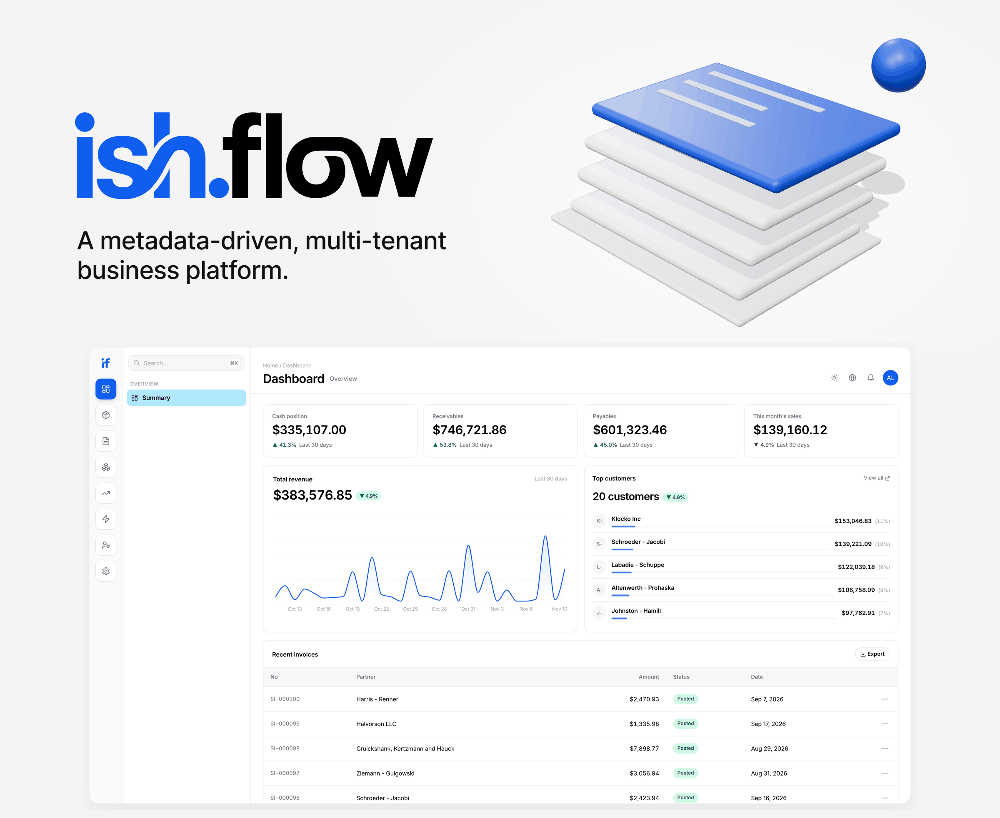
</p>

<p align="center">
  <a href="https://ishflow.com/ai/projects/ishflow">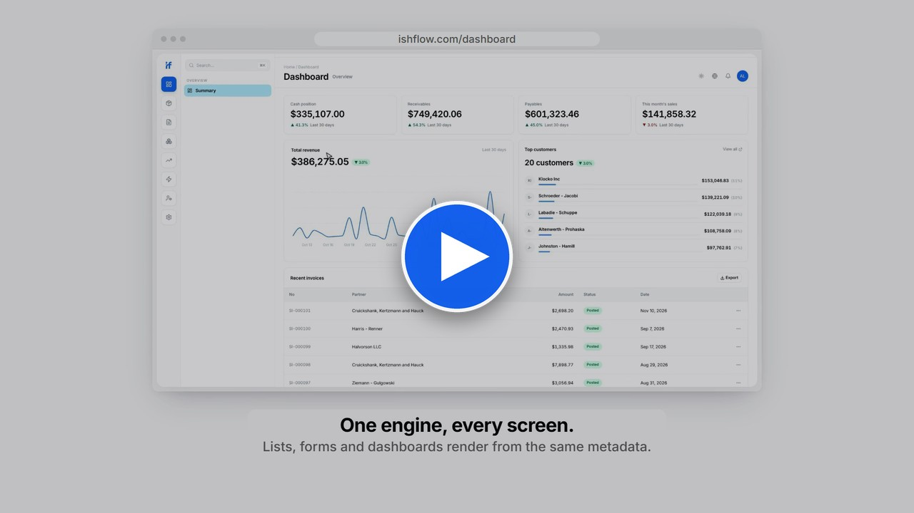</a>
</p>

## Why

1C:Enterprise runs a large share of small and mid-size business accounting in Russian-speaking markets. Its core idea is still one of the best in business software: you do not hand-build every screen and table, you describe business objects (catalogs, documents, registers) as metadata, and the platform turns that description into a working application. Posting a document writes immutable movements into registers, and balances and reports are derived from those movements.

The idea is excellent; the delivery is dated. Desktop clients, a proprietary language and on-premise installs are a poor fit for small teams that expect a fast web app, a phone app and sensible pricing.

ishflow carries the 1C model onto a modern web stack: TypeScript metadata instead of a configurator, PostgreSQL with row-level security instead of per-client databases, Next.js and shadcn/ui instead of desktop forms, and native iOS and Android apps on the same engine.

## How it works

<table>
  <tr>
    <td width="50%" align="center">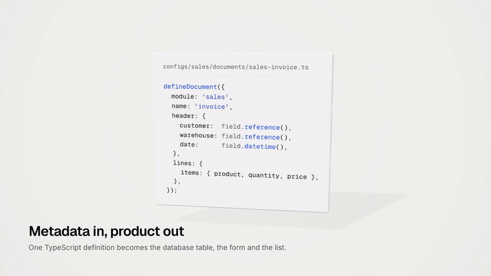<br><sub>Metadata in, product out</sub></td>
    <td width="50%" align="center">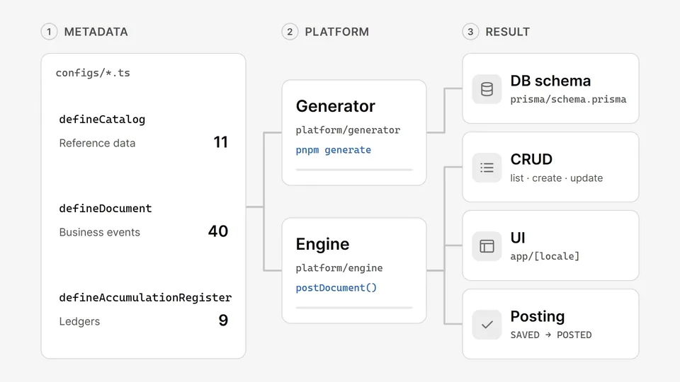<br><sub>From configs to web, API and mobile</sub></td>
  </tr>
</table>

Business objects live under `configs/` as TypeScript. This is the complete accounts receivable register, unedited ([source](configs/sales/registers/accounts-receivable.ts)):

```ts
import { defineAccumulationRegister, field } from '@/platform/metadata';

defineAccumulationRegister({
  module: 'sales',
  name: 'accounts_receivable',
  label: {
    en: 'Accounts Receivable',
    ru: 'Дебиторская задолженность',
    tr: 'Alacak Hesapları',
  },
  icon: 'Landmark',
  dimensions: {
    customer: field.reference({
      label: { en: 'Customer', ru: 'Клиент', tr: 'Müşteri' },
      required: true,
      to: { kind: 'ref', module: 'sales', name: 'customer' },
    }),
    relatedDocRef: field.string({
      label: { en: 'Related Document', ru: 'Связанный документ', tr: 'İlgili Belge' },
    }),
  },
  resources: {
    amount: field.money({
      label: { en: 'Amount', ru: 'Сумма', tr: 'Tutar' },
      required: true,
    }),
  },
  listColumnOrder: ['customer', 'amount', 'kind', 'timestamp', 'docRef'],
});
```

Documents declare a header, line sections and a `posting` map: one function per register that turns the document into movements. An excerpt from the sales invoice ([source](configs/sales/documents/sales-invoice.ts)):

```ts
defineDocument({
  module: 'sales',
  name: 'invoice',
  header: {
    customer: field.reference({ /* ... */ to: { kind: 'ref', module: 'sales', name: 'customer' } }),
    warehouse: field.reference({ /* ... */ to: { kind: 'ref', module: 'inventory', name: 'warehouse' } }),
  },
  lines: {
    items: {
      fields: {
        product: field.reference({ /* ... */ referenceFilter: 'hasStockGt0' }),
        quantity: field.number({ /* ... */ min: 1 }),
        price: field.money({ /* ... */ }),
      },
    },
  },
  posting: {
    'inventory.stock_balance': async (doc, ctx) => { /* outgoing stock at average cost */ },
    'sales.accounts_receivable': async (doc, ctx) => { /* customer owes subtotal + VAT */ },
    'finance.vat': async (doc, ctx) => { /* output VAT */ },
    'sales.sale': async (doc, ctx) => { /* revenue and cost per line */ },
  },
  validators: {
    prePost: [/* block posting on insufficient stock or below-cost prices */],
  },
});
```

From these files:

1. **Schema.** `pnpm generate` reads every config and writes the Prisma models, TypeScript types and navigation manifest. Each generated table carries a tenant column covered by row-level security.
2. **CRUD.** One generic engine (`platform/engine`) lists, creates, updates, soft-deletes and restores any catalog or document, with Zod validation built from the field definitions.
3. **Screens.** List, form and detail pages render from the same metadata: a `field.reference` becomes a searchable combobox, a line section becomes an editable table, labels come from the config in the active language.
4. **Posting.** Clicking Post runs every posting function inside one serializable transaction, writes the movements, flips the document to `POSTED` and records an audit entry. Unposting deactivates movements instead of deleting them.

<p align="center">
  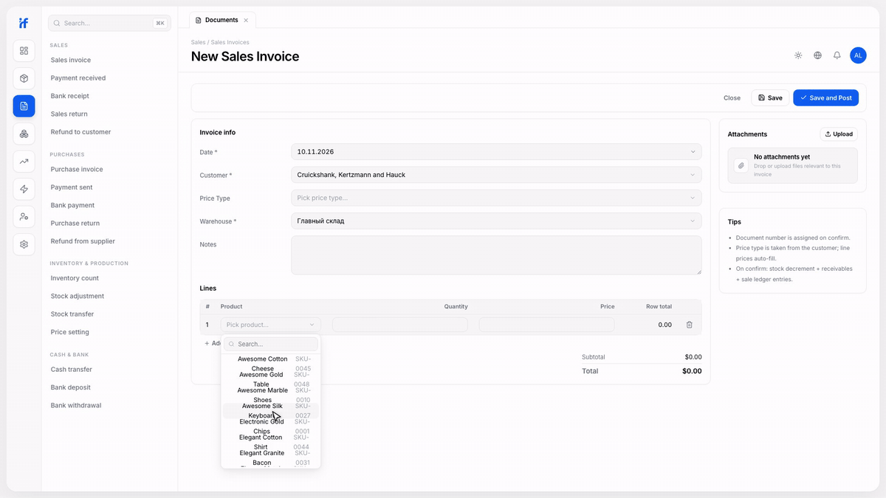<br>
  <sub>Creating and posting a sales invoice</sub>
</p>

## Features

- **Metadata engine:** 40 document types, 11 catalogs and 10 registers (9 accumulation, 1 information) across sales, purchases, inventory, treasury, finance and fixed assets, all defined in `configs/`.
- **Posting and ledgers:** immutable register movements, balances and turnovers as of any date, average-cost inventory, VAT, pre-post validators.
- **Reports:** 15 metadata-defined report views, including aging, gross profit, income statement, cash flow, inventory valuation, slow stock and turnover reports for receivables, payables, sales and stock.
- **Multi-tenancy:** PostgreSQL row-level security on every tenant table; the app connects as a non-superuser role so policies are always enforced.
- **Roles and permissions:** 9 built-in tenant roles (owner, admin, chief accountant, bookkeeper, sales, warehouse, cashier, buyer, viewer); navigation, dashboard and reports adapt to the user's permissions.
- **Multilingual:** eight locales are wired up via next-intl (Russian default, English, Turkish, Uzbek, Kyrgyz, German, French, Chinese). Russian, English, Turkish, Uzbek and Kyrgyz are translated; German, French and Chinese are mostly English placeholders.
- **Light and dark themes** throughout, built on shadcn/ui design tokens.
- **Native mobile apps:** SwiftUI for iOS and Kotlin with Jetpack Compose for Android, focused on daily operations (sales, purchases, payments, stock) against the same backend.

<p align="center">
  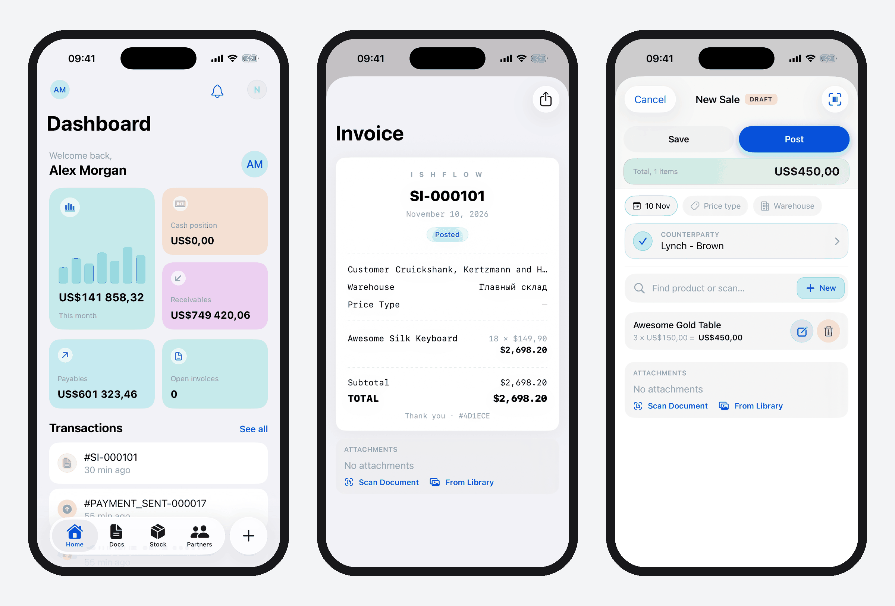<br>
  <sub>Native iOS app (SwiftUI) running against the same engine</sub>
</p>

- **Public API and MCP:** a REST API (`/api/v1`) with API keys, and a Model Context Protocol server (`/api/mcp`) that lets AI agents read and post documents through the same engine. See [`packages/mcp-tools`](packages/mcp-tools/README.md).
- **Operator console:** a super-admin area for tenants, users, audit log, support tickets and feature flags.
- **Audit trail:** every create, update, post and unpost is logged with its source (web, mobile, API, MCP).

<table>
  <tr>
    <td width="50%" valign="top">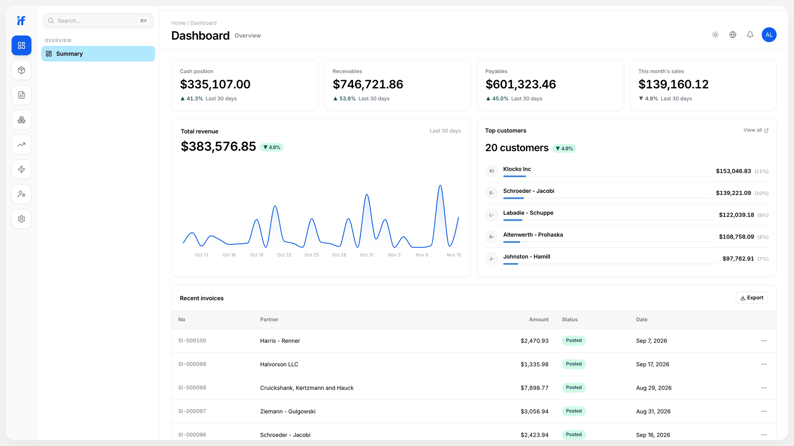<br><sub>Dashboard</sub></td>
    <td width="50%" valign="top">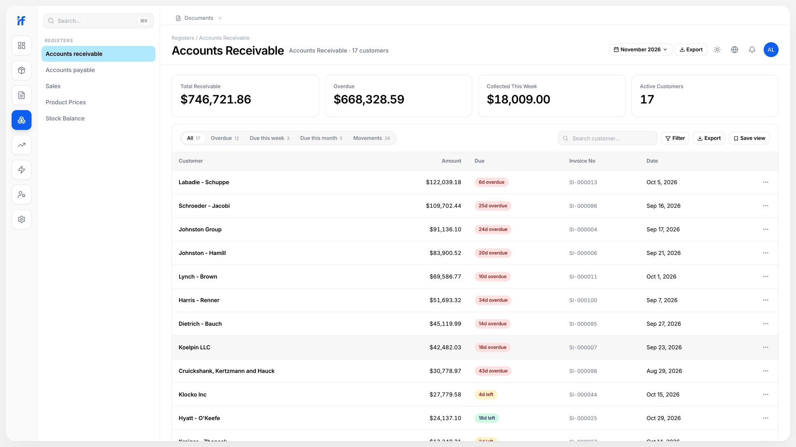<br><sub>Registers</sub></td>
  </tr>
  <tr>
    <td width="50%" valign="top">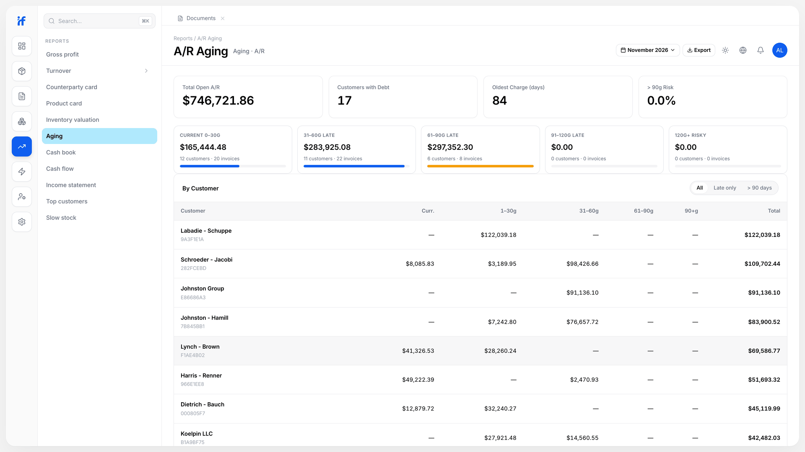<br><sub>Reports</sub></td>
    <td width="50%" valign="top">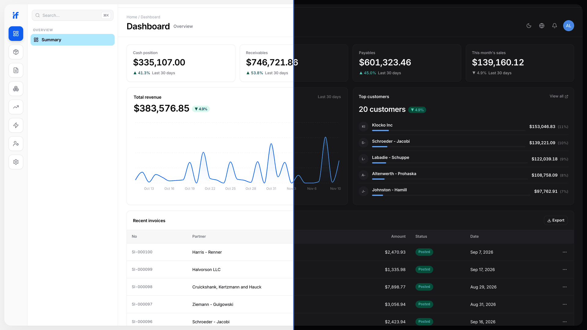<br><sub>Light and dark themes</sub></td>
  </tr>
  <tr>
    <td width="50%" valign="top">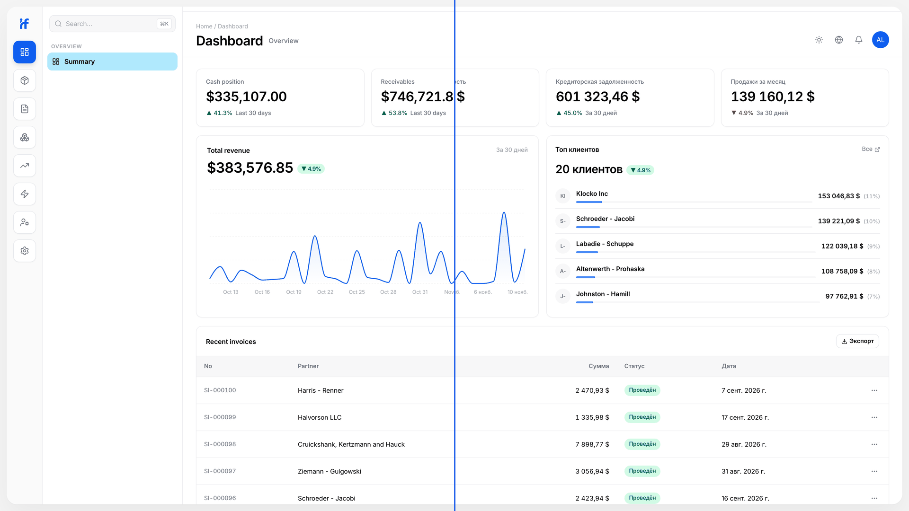<br><sub>English and Russian</sub></td>
    <td width="50%" valign="top">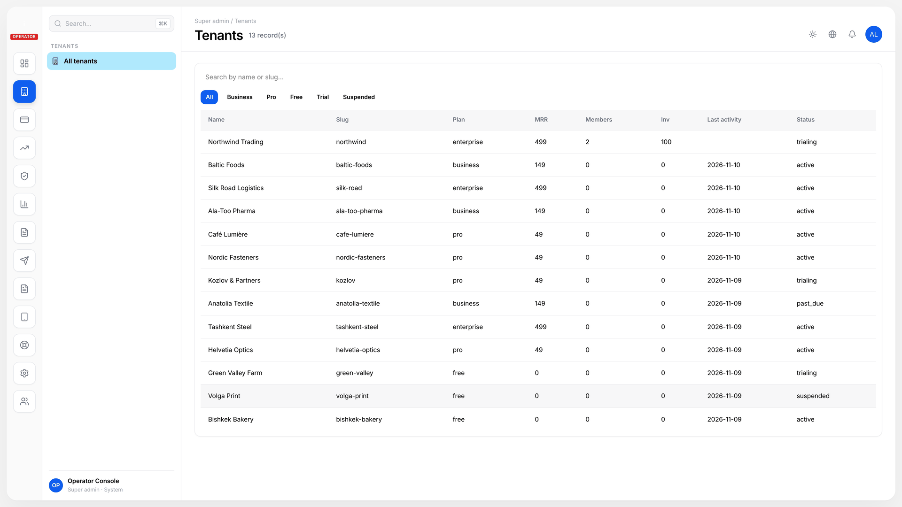<br><sub>Operator console</sub></td>
  </tr>
</table>

## Architecture

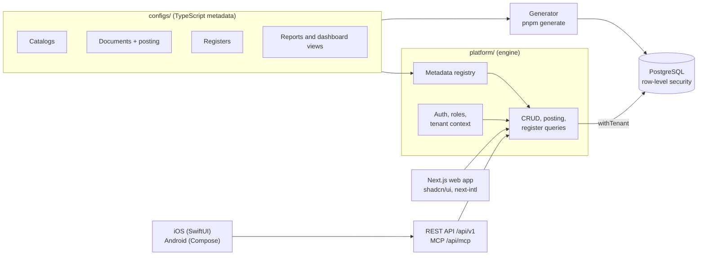

More detail in [docs/ARCHITECTURE.md](docs/ARCHITECTURE.md). A guided screen tour is in [docs/SHOWCASE.md](docs/SHOWCASE.md).

## Tech stack

| Layer | Choice |
|---|---|
| Web | Next.js 16 (App Router), React 19, TypeScript (strict) |
| UI | Tailwind CSS 4, shadcn/ui, Recharts, next-themes |
| i18n | next-intl, 8 locales wired up (5 translated) |
| Data | PostgreSQL 16, Prisma, row-level security |
| Auth | Clerk (users and organizations), mobile JWT, API keys |
| Billing | Stripe |
| AI integration | Model Context Protocol server (`@modelcontextprotocol/sdk`) |
| Mobile | SwiftUI (iOS 26+), Kotlin and Jetpack Compose (Android, min SDK 34) |
| Quality | Vitest, Playwright, Biome |
| Hosting | Vercel |

## Repository map

```
configs/            business metadata: one folder per module (sales, purchases, inventory, ...)
platform/
  metadata/         the DSL: defineCatalog, defineDocument, defineAccumulationRegister, field.*
  generator/        codegen: Prisma models, types, navigation
  engine/           CRUD, posting, register queries, permissions, audit, period close
  db/               Prisma client, withTenant / withBypass (RLS)
  auth/             session context, roles, API keys, mobile tokens
  i18n/             locale config and routing
app/[locale]/       Next.js routes: dashboard, catalogs, documents, registers, reports, settings
app/api/            REST API (v1), MCP endpoint, mobile API, webhooks, cron
components/         shared UI (shadcn/ui primitives and app components)
messages/           translation catalogs, one JSON file per locale
prisma/             schema and migrations
packages/           MCP tools, mobile API contract
ios-native/         SwiftUI app
android-native/     Kotlin / Jetpack Compose app
tests/e2e/          Playwright specs
```

The codebase has 384 Vitest test files (unit tests sit next to their source as `*.test.ts`) and 41 Playwright specs.

## Running locally

ishflow needs Node.js, pnpm and Docker. A development auth bypass skips sign-in, so you can explore the app without creating an account.

```bash
git clone https://github.com/ishflow/ishflow-platform.git ishflow && cd ishflow
pnpm install

# 1. Local PostgreSQL
docker compose up -d postgres

# 2. Environment
cp .env.example .env.local
```

Edit `.env.local`:

- `DATABASE_URL`: the `canalog_app` role on `localhost:5432/canalog_dev`. Its local password is set in `prisma/migrations/20260415113837_add_app_role/migration.sql`. This must be the non-superuser role, otherwise row-level security is not enforced.
- `DIRECT_URL`: the `canalog` superuser (used for migrations and seeding), password from `docker-compose.yml`.
- `DEV_AUTH_BYPASS=1` and `NEXT_PUBLIC_APP_URL=http://localhost:3100`.
- `NEXT_PUBLIC_CLERK_PUBLISHABLE_KEY` and `CLERK_SECRET_KEY` from a free Clerk development instance. The Clerk provider is always mounted, so the keys must be valid even though the bypass skips sign-in.

Payments, email, file storage and push notifications are read lazily and can stay empty.

```bash
# 3. Schema
pnpm db:deploy
pnpm prisma generate

# 4. Dev tenant and demo data
node scripts/seed-dev-bypass.mjs   # creates the bypass tenant and owner user
pnpm db:seed                       # customers, suppliers, products, invoices, payments, warehouses

# 5. Run
pnpm dev
```

Open http://localhost:3100/en/dashboard (Russian is the default locale and has no prefix: http://localhost:3100/dashboard). The bypass is ignored when `NODE_ENV` is `production`.

Other commands: `pnpm test` (Vitest), `pnpm test:e2e` (Playwright), `pnpm typecheck`, `pnpm lint`, `pnpm generate` (regenerate schema after changing `configs/`).

## Project status

ishflow was built between April and June 2026. It is a working product: web app, both native apps, public API and MCP server ran against a shared production backend. Active development has stopped, and the repository is published as a showcase of the architecture and the product. Issues and pull requests are not being reviewed.

## License

Source-available, all rights reserved. Viewing and personal evaluation are permitted; redistribution and commercial use are not permitted without written permission. See [LICENSE](LICENSE).

## Author

Designed and built by Uba, a product designer, as a solo project.
