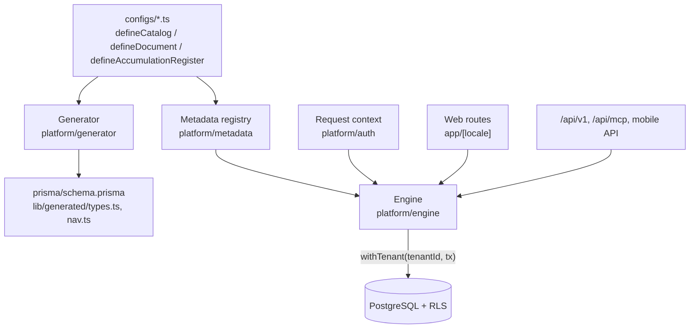

# Architecture

ishflow is split into two layers. The **platform** (`platform/`) is the engine: written once and changed rarely. The **configuration** (`configs/`) is the fuel: TypeScript files that describe business objects. Adding a document type means adding a file, not changing the engine. This mirrors the configuration model of 1C:Enterprise, moved onto Next.js and PostgreSQL.



## 1. Metadata DSL

`platform/metadata` exposes a small set of `define*` functions. Each call validates the config and adds it to an in-memory registry; `configs/index.ts` imports every config so any entry point sees the full registry.

| Kind | Purpose | Count |
|---|---|---|
| `defineCatalog` | Reference data: customers, products, warehouses, bank accounts | 11 |
| `defineDocument` | Business events: invoices, payments, transfers, stock counts | 40 |
| `defineAccumulationRegister` | Ledgers with dimensions and resources: stock, receivables, cash | 9 |
| `defineInformationRegister` | Time-based facts: product prices | 1 |
| `defineReportView`, `defineDashboardWidget`, `defineRegisterView`, `defineSettings`, `defineSuperAdminCatalog` | Read-side screens described as data | |

Fields are built with `field.*`: `string`, `text`, `number`, `money`, `boolean`, `date`, `datetime`, `reference`, `docNumber`, `docRef`, `documentLink`, `color`. Every field carries its own labels per language, validation rules (`required`, `min`) and presentation hints (`formHidden`, `referenceFilter`).

A document config has four parts:

- `header`: document-level fields (date, counterparty, warehouse).
- `lines`: one or more tabular sections, each with its own fields and minimum row count.
- `posting`: a map from register id to a function that turns the document into movements.
- `validators.prePost`: checks that run before posting and can block it with a translated message (for example insufficient stock, or a price below cost).

Configs can also declare permissions, row actions (for example "Record payment" on a posted invoice with an open balance, which opens a pre-filled payment document) and list column order.

## 2. Generator

`pnpm generate` (`platform/generator/run.ts`) clears the registry, loads every config, and writes three outputs:

1. **Prisma models**, spliced into a marked block of `prisma/schema.prisma`. Each catalog, document, document line section and register movement table gets a `tenantId` column, soft-delete and timestamp columns, and tenant-leading indexes. Unique constraints are always composite with `tenantId`, so deterministic values like document numbers never collide across tenants.
2. **TypeScript types** in `lib/generated/types.ts`.
3. **Navigation manifest** in `lib/generated/nav.ts`.

Generated output is committed. Database changes then go through normal Prisma migrations; row-level security policies for new tables are added in those migrations.

## 3. Engine

`platform/engine` is a single generic implementation used by the web UI, the REST API, the mobile API and the MCP server.

- **CRUD** (`crud.ts`, `document-crud.ts`): list with paging, create, update, soft delete, restore. Input is validated by a Zod schema built from the field definitions (`zod-schema.ts`).
- **Permissions** (`permissions.ts`): every operation maps to a permission code such as `sales.invoice:post`. `check()` throws on the server; `can()` lets the UI hide or disable actions the engine would reject.
- **Register queries** (`register-query.ts`): balance, balance as of a date, grouped balances, turnover over a period, paged movement lists.
- **Audit** (`audit-log.ts`): each mutation writes an audit row with its source: web, mobile, API or MCP.

### Posting

Posting follows the 1C document lifecycle: a document is saved first, then posted, and can be unposted.

```
SAVED --post--> POSTED --unpost--> SAVED
```

`postDocument` (`platform/engine/posting.ts`) runs in one `Serializable` transaction:

1. Take advisory locks for every target register in sorted order, so concurrent posts cannot deadlock.
2. Load the document and its lines; confirm it is `SAVED`, inside the user's data scope, and in an open accounting period.
3. Run the `prePost` validators, then each posting function. Posting functions receive a read-only context (`ctx.register(id).balance(...)`) so they can price outgoing stock at the current average cost.
4. Insert the movements, set the document to `POSTED` with `postedAt`, `postedBy` and an incremented `version`.
5. Write the audit row and commit. Notifications are sent after the commit and never block it.

Register movements are an immutable ledger. Unposting marks a document's movements inactive instead of deleting them, and reposting writes a fresh set. Balances are sums over active movements, so any report can be recomputed from history.

## 4. Multi-tenancy and row-level security

All tenants share one PostgreSQL database. Isolation is enforced by the database, not by application filters:

- Tenant tables have row-level security policies that compare `tenant_id` with the session setting `app.tenant_id`.
- `withTenant(tenantId, fn)` (`platform/db/tenant-context.ts`) opens a transaction, validates the id as a UUID and sets `app.tenant_id` for that transaction only.
- The runtime connection uses a role without `SUPERUSER` or `BYPASSRLS`. A startup guard (`platform/db/role-guard.ts`) checks this and refuses to serve traffic in production if the role could bypass the policies.
- `withBypass` exists for trusted server work such as identity sync and migrations, and is not used in request handlers that serve tenant users.
- Migrations and seeding use a separate superuser connection (`DIRECT_URL`).

## 5. Identity and roles

Each request resolves an `AppContext` (`platform/auth/current-context.ts`): user, active tenant, role, permission set and data scopes. Web sessions come from Clerk organizations; the mobile apps use signed JWTs; the REST API and MCP use hashed API keys tied to a tenant.

Every tenant is seeded with 9 system roles (owner, admin, chief accountant, bookkeeper, sales, warehouse, cashier, buyer, viewer). Navigation, dashboard widgets and report groups are filtered by the same permission codes the engine enforces, so a user never sees a screen that would fail on submit. A separate platform-admin check guards the cross-tenant operator console.

## 6. UI

Routes live under `app/[locale]/`. Document, catalog and register pages are thin wrappers around shared renderers that read the registry: a reference field becomes a searchable combobox filtered by `referenceFilter`, a line section becomes an editable table, a report view returns sections (KPI cards, charts, ranked lists, aging buckets, profit and loss rows) that one shell knows how to draw.

Components are shadcn/ui, styled only with theme tokens, so every screen works in light and dark mode.

## 7. Internationalization

- Interface strings go through next-intl. Catalogs live in `messages/<locale>.json` for 8 locales: `ru` (default, no URL prefix), `en` (fallback), `tr`, `uz`, `ky`, `de`, `fr`, `zh`. Russian, English, Turkish, Uzbek and Kyrgyz are translated; German, French and Chinese are mostly English placeholders.
- Business object labels (field names, document titles) live in the metadata itself, so a new document arrives translated.
- The native apps carry their own localized string catalogs.

## 8. Clients

| Client | Path | Notes |
|---|---|---|
| Web | `app/[locale]` | Full product: operations, master data, reports, settings, administration |
| REST API | `app/api/v1` | Customers, products, invoices, stock balances; API-key auth |
| MCP server | `app/api/mcp`, `packages/mcp-tools` | Generic tools (`catalog_list`, `document_post`, `register_balance`, `report_run`, ...) that dispatch into the engine by config id |
| iOS | `ios-native` | SwiftUI, modular Swift packages per feature |
| Android | `android-native` | Kotlin, Jetpack Compose, Material 3, one Gradle module per feature |

The mobile apps cover daily operations (sales, purchases, payments, stock, prices); master data and administration stay on the web.
