# Showcase

A short tour of ishflow, from the dashboard to a posted document and the ledgers it updates. Screens use the demo data from `pnpm db:seed`. Routes are shown with the English prefix (`/en`); Russian is the default locale and has no prefix.

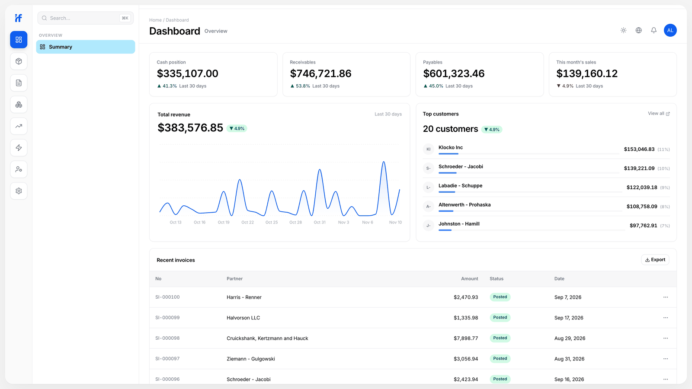

## 1. Dashboard

Route: `/en/dashboard`

KPI strip (cash, receivables, payables, sales), revenue chart, recent invoices and top customers. Each widget is a dashboard widget definition under `configs/dashboard/widgets/`, and the set a user sees follows their role.

## 2. From metadata to a form

Route: `/en/documents/sales-invoice/new`

The sales invoice form is rendered from [`configs/sales/documents/sales-invoice.ts`](../configs/sales/documents/sales-invoice.ts): header fields (customer, price type, warehouse), a line table (product, quantity, price) and a product picker that only offers items in stock at the chosen warehouse.

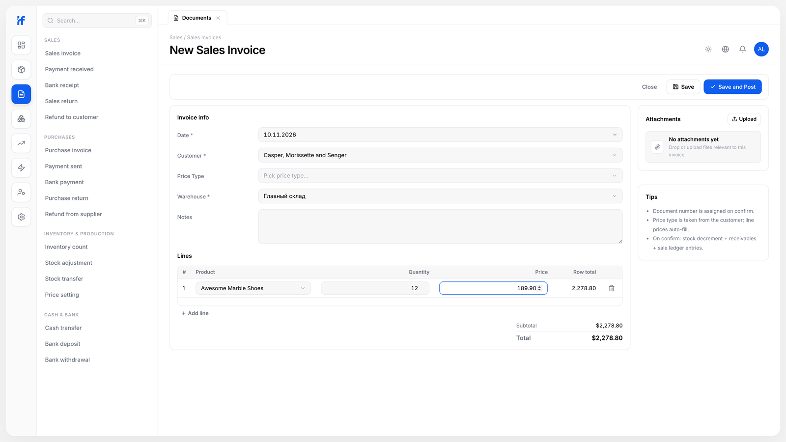

## 3. Posting

Route: `/en/documents/sales-invoice/<id>`

Saving and then posting the invoice writes movements into four registers in one transaction: stock leaves the warehouse at average cost, the customer's receivable grows by the gross amount, output VAT is recorded, and revenue and cost land in the sales register. Posting is blocked with a clear message when stock is insufficient or a price is below cost.

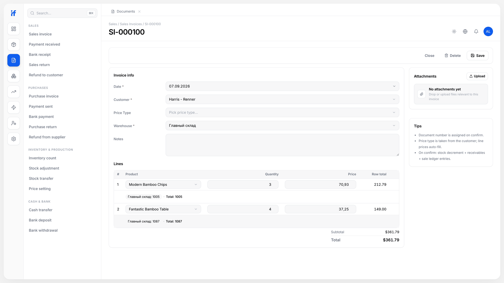

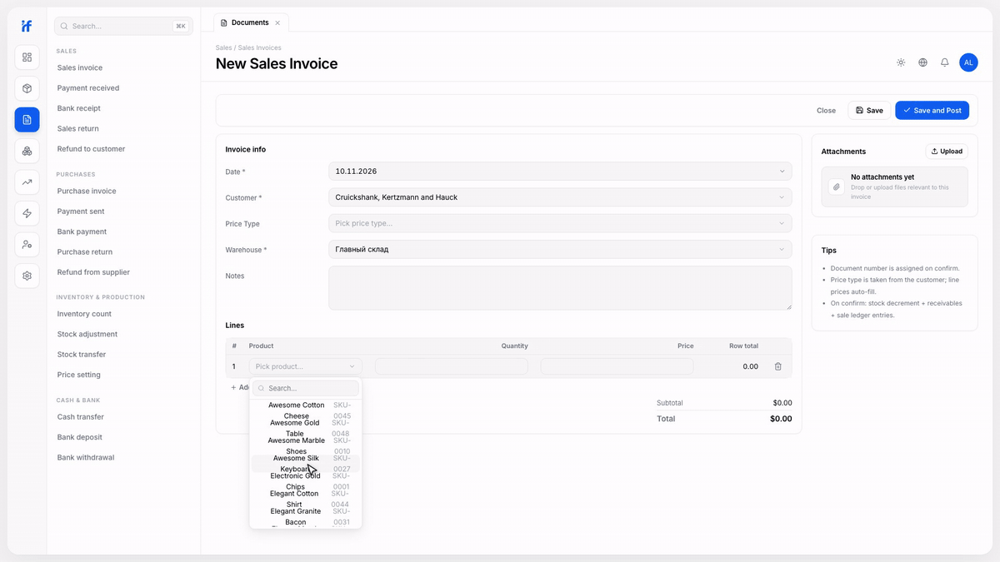

## 4. Registers

Routes: `/en/registers/stock-balance`, `/en/registers/accounts_receivable`, `/en/registers/sales`

The ledgers the invoice just updated. The accounts receivable register is the 29-line config shown in the README; its list screen comes from that file.

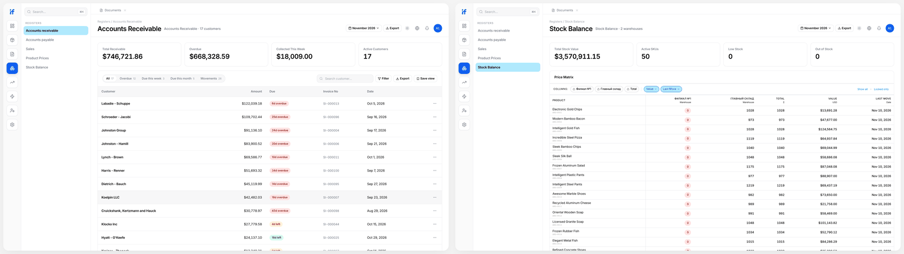

## 5. Reports

Routes: `/en/reports`, `/en/reports/aging`, `/en/reports/gross-profit`, `/en/reports/income-statement`, `/en/reports/inventory-valuation`

Report views are metadata too: each returns typed sections (KPI cards, charts, ranked lists, aging buckets, profit and loss rows) drawn by one shared shell.

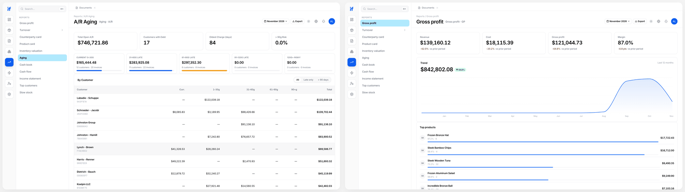

## 6. Catalogs

Routes: `/en/catalogs/partners/customers`, `/en/catalogs/products`

Catalogs are metadata too: the product list with search, filters, status groups and export is generated from a catalog definition. Customer lists and a 360 view per record (balance, related documents and history) follow the same pattern.

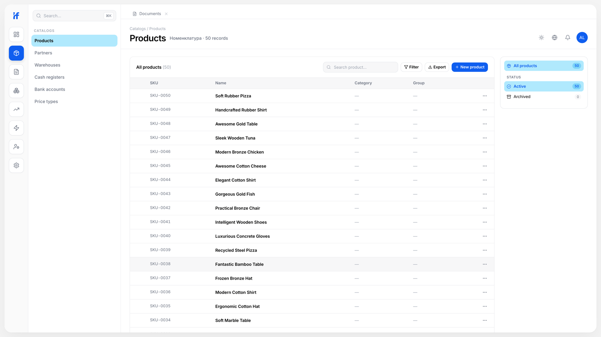

## 7. Languages and themes

The same screens in Russian and English, light and dark. Interface strings come from `messages/<locale>.json`; field and document names come from the metadata.

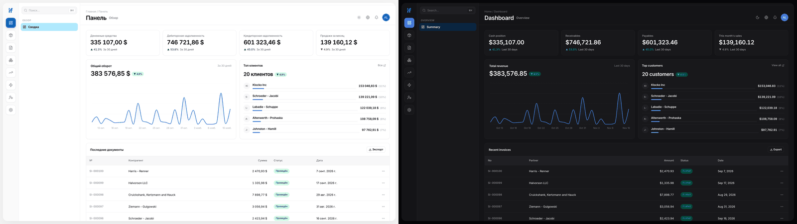

## 8. Operator console

Routes: `/en/super-admin/tenants`, `/en/super-admin/system/features`

Cross-tenant administration: tenant list and detail, users, audit log, support tickets and feature flags that hide a module without deleting it.

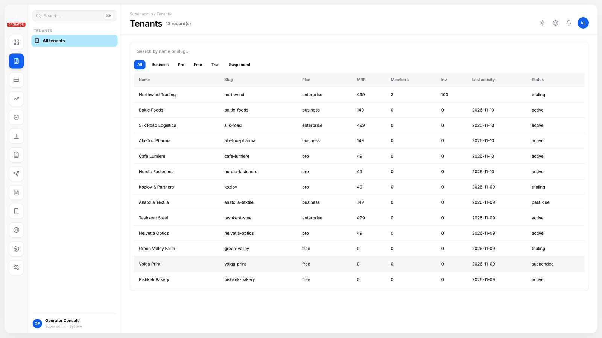

## 9. Mobile

Native iOS (SwiftUI) and Android (Jetpack Compose) apps for daily operations run against the same backend: sales and purchase documents, payments, stock and prices. Their sources are in `ios-native/` and `android-native/`. The screens below are the iOS app (iPhone simulator, demo data).

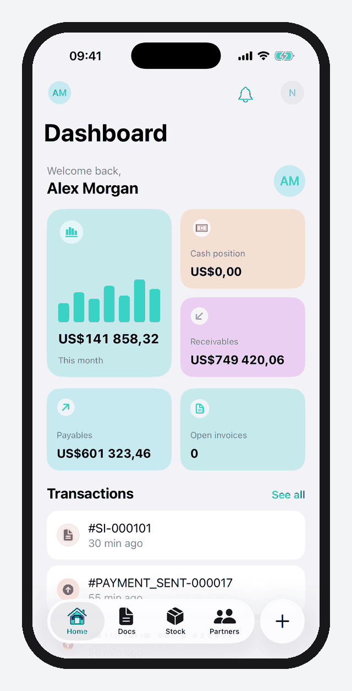
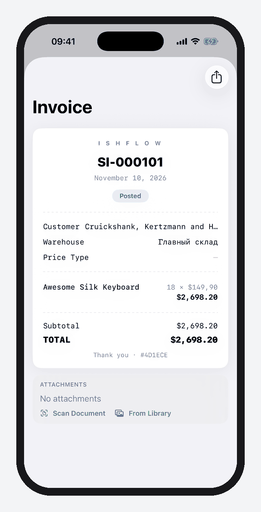
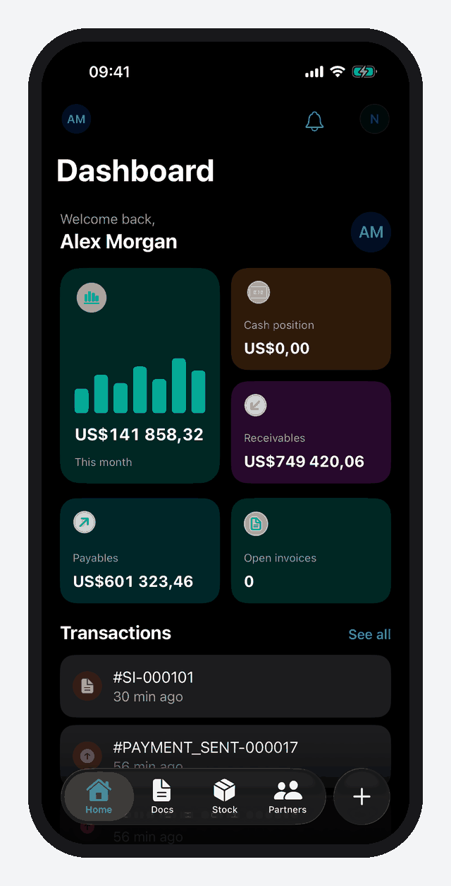
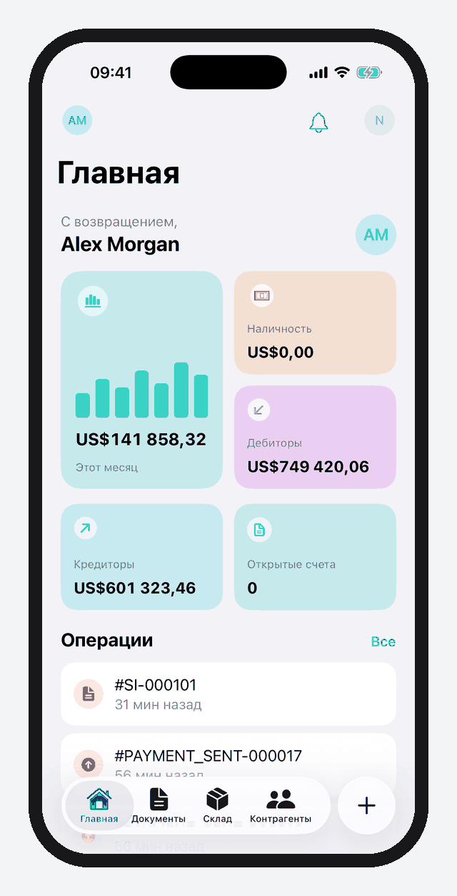

## Film

[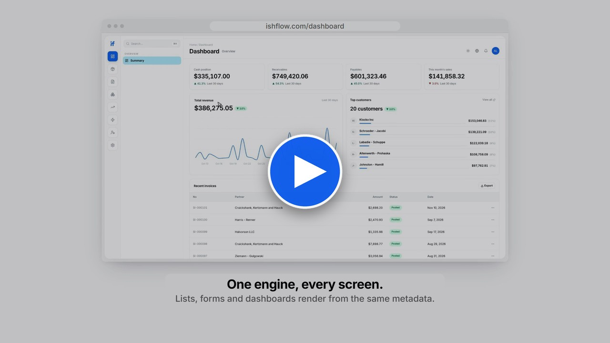](https://ishflow.com/ai/projects/ishflow)
